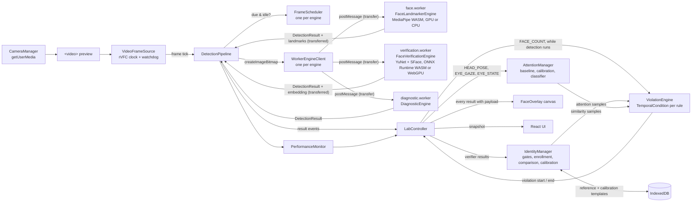

# Architecture

Status: Phase 4. MediaPipe Face Landmarker runs in its own worker and feeds the temporal evaluation and violation engine (`NO_FACE`, `MULTIPLE_FACES`). Its head pose, gaze, and eye measurements feed the main-thread attention layer, which judges them against the person's own screen area (`GAZE_AWAY`, `GAZE_AWAY_REPEATED`, `HEAD_TURNED`, `EYES_CLOSED`). The face verifier (YuNet + SFace on ONNX Runtime Web) runs in a second worker; its embeddings feed enrollment, threshold calibration, and `FACE_MISMATCH` through the main-thread identity layer. The model-free diagnostic engine from Phase 1 stays available (disabled by default) for pipeline measurements.

## Data flow



The camera preview and the UI run on the main thread. Each engine instance runs in its own dedicated worker. The main thread only decides which engine gets a frame, copies that frame once into an `ImageBitmap`, and transfers it (zero-copy) to the worker.

## Layers

| Layer                     | Modules                                                                    | Status (Phase 4)                                                                                              |
| ------------------------- | -------------------------------------------------------------------------- | ------------------------------------------------------------------------------------------------------------- |
| Camera capture            | `src/capture/CameraManager.js`                                             | Implemented                                                                                                   |
| Frame clock and capture   | `src/capture/VideoFrameSource.js`                                          | Implemented                                                                                                   |
| Frame scheduling          | `src/capture/FrameScheduler.js`, `src/pipeline/DetectionPipeline.js`       | Implemented                                                                                                   |
| Detection engines         | `src/engines/*`, `src/workers/*`                                           | Diagnostic engine; MediaPipe Face Landmarker (`face/`); face verifier (`verification/`)                       |
| Observation normalization | `src/engines/EngineContract.js` (`Observation`, `validateDetectionResult`) | `FRAME_PROBE`, `FACE_COUNT`, `FACE`, `FACE_EMBEDDING`, `HEAD_POSE`, `EYE_GAZE`, `EYE_STATE`                   |
| Identity                  | `src/identity/*`                                                           | Quality gates, enrollment, comparison with the reference, calibration (FAR/FRR/EER/ROC), storage              |
| Attention                 | `src/attention/*`                                                          | Baseline (calibration or learned), gaze/head/eye classification, presets                                      |
| Temporal evaluation       | `src/pipeline/TemporalCondition.js`, `GlanceCounter.js`                    | Implemented                                                                                                   |
| Violation / event engine  | `src/pipeline/ViolationEngine.js`                                          | `NO_FACE`, `MULTIPLE_FACES`, `FACE_MISMATCH`, `GAZE_AWAY`, `GAZE_AWAY_REPEATED`, `HEAD_TURNED`, `EYES_CLOSED` |
| Benchmarking and metrics  | `src/benchmark/PerformanceMonitor.js`, `stats.js`, `DeviceProfiler.js`     | Live metrics incl. per-model breakdown, export                                                                |
| Testing and ground truth  | `src/evaluation/` (planned)                                                | Phase 7                                                                                                       |
| UI                        | `src/app/*`, `src/ui/*`                                                    | Live testing (overlays, violations, engine cards, identity, calibration), environment                         |

`src/app/LabController.js` is the composition root. React components call its methods and render its snapshot through `useSyncExternalStore`; no detection logic lives in components.

## Engine contract

Defined with JSDoc in `src/engines/EngineContract.js`; lifecycle enforced by `src/engines/BaseDetectionEngine.js`.

```js
initialize(): Promise<void>                        // load model; records init timings
detect(frame, meta): Promise<DetectionResult>      // one frame; never concurrent
configure(patch): Promise<config>                  // live reconfiguration or CONFIGURE_UNSUPPORTED
dispose(): Promise<void>
getStatus(): EngineStatus                          // state, model, execution provider, timings, counters, last error, details
```

- `DetectionResult` carries `observations`, `processingTimeMs`, and a `timings` split into `preprocessMs`, `inferenceMs`, `postprocessMs` (measured with `StageTimer`), plus model and execution-provider identity, and optionally an engine-specific `payload` (face landmarks). Model loading is split into `moduleLoadMs`, `modelFetchMs`, `modelInitMs`, and `warmupMs`.
- `EngineStatus.details` holds engine-specific state that is not a metric (for the face engine: requested and actual delegate, fallback reason, last task creation times).
- An `Observation` is a raw fact (`type`, `detected`, optional `confidence`, `value`, `metadata`). `confidence` is the model's score and is not a probability unless an engine documents a calibration. Engines never emit violations.
- Frame ownership: the worker host closes every frame it receives once the request settles, including stale and rejected frames. Engines must not keep frames.
- Results are validated structurally at the worker boundary (`validateDetectionResult`) before they reach the main thread.

## Worker protocol

`src/workers/protocol.js`. One worker hosts one engine instance; each engine kind has its own worker entry file (`src/workers/<kind>.worker.js`) so bundles contain only that engine and memory attribution can tell kinds apart.

| Request     | Purpose                                        |
| ----------- | ---------------------------------------------- |
| `init`      | Load the engine module and call `initialize()` |
| `detect`    | Process one transferred `ImageBitmap`          |
| `configure` | Apply a partial configuration live             |
| `status`    | Return engine status                           |
| `dispose`   | Release resources                              |

Every request gets exactly one response (`ok: true` with a payload, or `ok: false` with a serialized error that keeps `name`, `code`, and the cause chain). Error classes set `name` from an explicit `errorName`, because minified builds rename classes (a Phase 1 build logged `bi` instead of `LabError`).

Events from the worker, outside any request:

| Event            | Meaning                                                                                                       |
| ---------------- | ------------------------------------------------------------------------------------------------------------- |
| `fatal`          | Uncaught error or unhandled rejection in the worker                                                           |
| `protocol-error` | The worker received a malformed message                                                                       |
| `csp-violation`  | The worker's Content Security Policy blocked something; surfaces as a `CSP_VIOLATION` worker error            |
| `egress-blocked` | The worker's egress guard refused a request to another origin; counted in `status.blockedRequests` and logged |

Result payloads (landmarks) may contain typed arrays. The host transfers their `ArrayBuffer`s to the main thread instead of copying them; only arrays that own their whole buffer are transferred, so an engine must never put a view of WASM memory into a payload.

`WorkerEngineClient` guarantees:

- At most one `detect` in flight per engine. A concurrent call is rejected with `EngineBusyError` and its frame is closed.
- Every request has a timeout. A `detect` timeout means the worker is hung: it is terminated and the engine enters the `error` state until `restart()`.
- `restart()` terminates the worker and starts a new one. Responses from an old worker generation are ignored. A frame in flight during a restart or unload is reported as `aborted`, not as a failure.
- `configure` and `dispose` wait for an in-flight `detect` inside the worker, so they never interleave with inference. A `configure` request gets the init timeout, because it can recreate the model (MediaPipe delegate switch). While it runs, the engine card shows the engine as `configuring`.

## Frame clock

`VideoFrameSource` produces one tick per new video frame:

1. `requestVideoFrameCallback` (rVFC), preferred. Its metadata provides the camera `captureTime`, which is used as the frame timestamp (Chrome 156 and Edge 157 supplied it for every frame in the smoke tests, and Chrome 156 and Firefox 157 in the real-webcam sessions).
2. `requestAnimationFrame` polling when rVFC is missing; a tick is emitted when `currentTime` changes and timestamps fall back to callback time.
3. Watchdog: rVFC only fires when the compositor presents a frame. If no callback arrives for `stallTimeoutMs` (500 ms) while the video is playing, the callback is re-armed and a timer emits ticks whenever the decoded-frame counter (`getVideoPlaybackQuality().totalVideoFrames`) advances, until rVFC resumes. Firefox 157 reports 0 decoded frames for camera streams, so the counter is trusted only after it has counted a frame; until then the timer detects new frames by a change of `currentTime`, and the stats report `playbackQuality: null`. A stream whose video track has ended is not treated as playing. Stalls and fallback ticks are counted in the stats. Browsers throttle rVFC on hidden pages (Firefox 157 ran it about once per second), so hidden periods also count as frame-clock stalls, and frames presented without a callback while hidden count as missed callbacks.

Timestamps are epoch-aligned (`performance.timeOrigin + performance.now()`) so main-thread and worker times can be compared. Alignment across threads is approximate (normally well below 1 ms).

## Frame scheduling

Each engine instance has its own `FrameScheduler`; it holds no frames and never queues.

- **Rate**: a due-time accumulator. A frame is due when it is within half a camera-frame interval of the due time; on dispatch the due time advances by exactly one interval. This holds the long-run rate on the camera's frame grid (a 7 FPS target on a 30 FPS camera averages 7, where "now − last ≥ interval" would give 7.5).
- **Backpressure**: if a slot comes due while the engine is still busy, nothing is captured. When the engine frees up, the next frame is dispatched and the phase restarts from there instead of bursting to catch up. The whole slots that were lost are counted as `skippedBusy`.
- **Stale frames**: the worker drops a frame before inference if it is older than `maxFrameAgeMs` when the worker starts on it (`droppedStale`).
- **Priority**: engines are evaluated in priority order on every frame. An engine with `yieldToHigherPriority` skips its slot while a higher-priority engine is still in flight (`skippedYield`), but for at most `maxYieldMs` past its due time, so it cannot be starved. Yielding avoids starting low-priority work alongside high-priority work; it cannot preempt work already running in another worker.
- **Capture size**: `capture.maxInputWidth` downscales during `createImageBitmap`, so engines with small model inputs do not receive full-resolution frames.

All rates and thresholds are configuration (`src/config/detection.config.js`, validated by Zod in `src/config/schema.js`). Defaults: `face-landmarker` at 5 FPS, priority 10, native camera resolution; `face-verifier` at 2 FPS, priority 5, yielding to higher priority for at most 300 ms, frames up to 1000 ms old, native resolution. The Phase 1 diagnostic instances are disabled by default: `probe-high` (5 FPS, priority 10) and `probe-low` (1 FPS, priority 1, 250 ms simulated blocking work, 640 px input, yields with `maxYieldMs` 500).

## Face engine (MediaPipe Face Landmarker)

`src/engines/face/FaceLandmarkerEngine.js`, hosted by `src/workers/face.worker.js`. The worker injects the MediaPipe runtime (`mediapipeRuntime.js`); unit tests inject fakes, so the engine logic is tested without WASM.

- **Task**: `@mediapipe/tasks-vision` 1.2.2 (exact version), `FaceLandmarker` in `VIDEO` mode: BlazeFace short-range detector, then Face Mesh V2 (478 landmarks) on each face. `numFaces` 3; detection, presence, and tracking confidence 0.5; blendshapes and transformation matrices on since Phase 4 (attention; no measurable latency cost with a face, see `docs/PHASE4_REPORT.md`). The delegate, `numFaces`, and the confidences are editable in the engine card; the outputs are configuration only.
- **Delegates**: `GPU` runs the models through WebGL2 on an `OffscreenCanvas` that MediaPipe creates in the worker; `CPU` runs them with XNNPACK in WASM (MediaPipe still creates a WebGL context for image conversion). If creating the GPU task fails and `allowCpuFallback` is on (default), the engine uses CPU and reports why in `status.details.fallbackReason`; the engine card shows it.
- **Delegate switch**: applied live in the same worker. A new task is created and warmed up while the old task keeps serving frames, then the old task is closed. MediaPipe clears `globalThis.ModuleFactory` after creating a task, so the runtime restores it from the WASM loader's default export before creating a second one. Other options (`numFaces`, confidences, outputs) are applied with `setOptions()` without recreating the task.
- **Timestamps**: `VIDEO` mode requires strictly increasing timestamps. The engine uses the camera capture time, rounded, and `previous + 1 ms` when a frame is not later than the previous one.
- **Warm-up**: one 64×64 blank image when a task is created. For GPU this compiles the shaders (3.3–3.5 s in the Phase 2 smoke runs). The first camera-size frame afterwards still takes longer than later ones (42–90 ms on GPU against about 10–15 ms).
- **Observations**: `FACE_COUNT` (`value` = number of faces, at most `numFaces`; `metadata.maxFaces`) and one `FACE` per face (`metadata.box` computed from the landmarks and clamped to the image, `truncated` when landmarks fall outside the image, `landmarkCount`). MediaPipe reports no per-face score, so these observations carry no `confidence`.
- **Payload**: `{ format: "mediapipe-face-landmarks", imageWidth, imageHeight, faces: [{ box, truncated, landmarks }] }`, where `landmarks` is a `Float32Array` of x, y, z per landmark (x and y normalized to the transferred frame). Transferred, not copied. Only the overlay uses it; it is not stored and not part of exported reports.
- **Status**: execution provider `mediapipe-gpu` or `mediapipe-cpu`; `status.details` = `requestedDelegate`, `delegate`, `fallbackReason`, `lastTaskCreation { delegate, createMs, warmupMs }`.
- **Assets**: the WASM loader and binary (ES-module variant only, 14.6 MB) come from the installed npm package. `scripts/vite-plugin-vendor-assets.js` (`scripts/vite-plugin-mediapipe-wasm.js` until Phase 3, now generalized to ONNX Runtime as well) serves them in dev and emits them into the build under `vendor/mediapipe/tasks-vision@1.2.2/`, together with a `LICENSE-NOTICE.txt`; the build fails if the installed package version differs from `MEDIAPIPE_TASKS_VISION_VERSION`. The model comes from `public/models/mp-face-landmarker/face_landmarker.task`, downloaded by `npm run fetch-models`, which keeps the file only if size and SHA-256 match `src/config/modelAssets.js`. The engine checks the SHA-256 again after loading and refuses a different file (`MODEL_INTEGRITY`).

The overlay (`src/ui/camera/FaceOverlay.jsx`) draws boxes, and landmarks when enabled, on a canvas over the preview. It subscribes to every result (`LabController.subscribeResults`) instead of the 500 ms snapshot, maps coordinates onto the letterboxed video, mirrors them with the preview, and clears boxes older than 1 s.

## Temporal evaluation and violations

`src/pipeline/ViolationEngine.js` reads `FACE_COUNT` from one source engine (`violations.sourceEngineId`, default `face-landmarker`) and evaluates each enabled rule with a `TemporalCondition` (`src/pipeline/TemporalCondition.js`). Engines never decide violations.

| Rule             | Condition on a frame          | Min duration | Clear after | Cooldown | Severity |
| ---------------- | ----------------------------- | -----------: | ----------: | -------: | -------- |
| `NO_FACE`        | `FACE_COUNT` = 0              |      1000 ms |      500 ms |  3000 ms | medium   |
| `MULTIPLE_FACES` | `FACE_COUNT` ≥ `minFaces` (2) |       700 ms |      500 ms |  3000 ms | high     |

These defaults are starting points from the plan (NO_FACE 800–1000 ms, MULTIPLE_FACES 500–800 ms), to be tuned against annotated recordings in Phases 7–8. Durations, `minFaces`, severity, and on/off are editable in the Violations panel and apply from the next frame; `maxGapMs` and the source engine are configuration only.

- **Times** are frame capture times, so processing delays do not shift them. Resolution is one sampling interval (200 ms at 5 FPS): with a 1500 ms minimum the smoke runs confirmed `NO_FACE` 1595–1646 ms after the onset frame.
- **Start**: the condition must hold on every frame for `minDurationMs`, measured from the first frame with the condition (the onset). The violation's `startedAt` is the onset; `confirmedAt` is the frame that confirmed it. Shorter runs are counted (`suppressedShort`).
- **End** (hysteresis): an active violation ends only after the condition was absent on every frame for `clearAfterMs`; `endedAt` is the first frame without the condition. A frame with the condition in between keeps it going.
- **Cooldown**: after a violation ended with reason `cleared`, the next one of the same type is not confirmed until `cooldownMs` has passed. Its `startedAt` is still its onset, so durations stay correct.
- **Gaps**: if two frames of the source engine are more than `maxGapMs` (2000 ms) apart, or the source stays silent that long (checked every UI refresh), nothing is known about that time: an active violation ends at its last known frame with reason `data-gap`, without cooldown, and a pending run is dropped. Unloading or restarting the source engine ends it the same way.
- **Detection state**: violations are evaluated only while detection runs. Stopping detection ends active violations with reason `stopped`; results of frames still in flight are ignored. Starting detection clears the violation history; resetting metrics does not.
- **Hidden page**: a violation that overlaps a period with the page hidden is flagged `pageHidden`, because browsers deliver few or no frames then. Evaluation is not paused.
- **Records**: each violation has `type`, `severity`, `status`, `startedAt`, `confirmedAt`, `endedAt`, `durationMs`, `endReason` (`cleared`, `data-gap`, `stopped`, `disabled`, `reference-changed`), `frames`, `maxFaceCount` (face rules) or `minSimilarity` (FACE_MISMATCH), `pageHidden`, `sourceEngineId`. The history keeps the latest 200; per-rule statistics count violations, durations, end reasons, and runs delayed or suppressed by the cooldown. Starts are logged as warnings ("NO_FACE started (no face for 1.0 s, severity medium)"), ends as info. Reports include the history and the effective rules.

`FACE_MISMATCH` (Phase 3) uses the same machinery with a different input: the main thread's identity layer passes one similarity sample per compared frame (`ViolationEngine.observeIdentity`), and the rule holds when the similarity is below `similarityThreshold` (default 0.363, OpenCV Zoo's SFace default; minimum duration 2000 ms, clear after 1000 ms, cooldown 5000 ms, severity high). Frames that are not compared (no face, failed verification gate, no reference, other recognizer model) send no sample, so they count as missing frames: after `maxGapMs` without a comparison an active mismatch ends with `data-gap`. Deleting or replacing the reference ends it with `reference-changed`. FACE_MISMATCH violations record `minSimilarity` (lowest similarity) instead of `maxFaceCount`.

## Attention: head pose, gaze, eye state

Measuring happens in the face worker; judging happens on the main thread, against the person's own baseline.

**Measurements** (`src/engines/face/faceGeometry.js`, called by `FaceLandmarkerEngine` for the largest face; blendshapes and transformation matrices are on by default). Angles are degrees from the person's point of view: yaw > 0 means to their right (the image's left in an unmirrored frame), pitch > 0 up, roll > 0 toward the right shoulder.

- `HEAD_POSE`: yaw and pitch are the direction of the face's forward axis (the matrix's rotated +Z, camera space X right, Y up, Z toward the camera); roll is the tilt of its up axis. The data layout is detected from where the translation is. MediaPipe 1.2.2 delivers column-major data (checked on a real portrait).
- `EYE_GAZE`: the iris centre (Face Mesh 468/473; the ring nearer each eye is used) is measured against the midpoint of the eye corners, along the eye line, in eye widths. An eye model turns this and the head pose into the gaze direction relative to the camera: iris radius 0.37 eye widths from the eyeball centre, corners 0.15 eye widths in front of it, eye width foreshortened by the head yaw. The eyes' part is gaze minus head pose. Eyes are weighted by apparent width; an eye with a blink score above 0.5 is left out.
- `EYE_STATE`: MediaPipe's `eyeBlinkLeft` and `eyeBlinkRight`, and the eye aspect ratio of each eye (two lid distances over the corner distance).

**Baseline** (`src/attention/attentionModel.js`, `attentionCalibration.js`). A profile holds the gaze direction at the screen centre, the extent of the screen to each side, the head pose at the centre, and the open-eye aspect ratio.

- Calibration: a dot at the centre, the four corners (6% in from the edges), and the centre again. For each target there are 800 ms to settle, then 1200 ms of sampling; at least 3 usable frames are needed (one face, gaze measured, blink score below 0.3), and a gaze spread of at most 4°. A target is repeated up to 3 times.
  - Extents are extrapolated from the corner targets to the viewport edges (× 0.5 / 0.44).
  - The run fails if any side is below 1° (the eyes did not follow the dot).
  - It warns when the two centre measurements differ by more than 8°, or when not in full screen.
  - Frames during calibration are not evaluated by the rules.
- Learned baseline (no calibration): the median gaze and head pose of usable frames during the first 10 s of detection (at least 20 frames), with the default screen size (±17° horizontally, ±10° vertically). It is learned again at every detection start; a calibration is kept until reset.

**Classification** (`AttentionClassifier`). Every frame becomes a sample with three parts, each with its angles, its excess beyond the limit and the direction, or a reason when undecided:

- Gaze: away when the gaze relative to the screen centre lies outside the screen extent plus `marginDeg` (5°), with `extraDownMarginDeg` (5°) more below. Once away, it is back only `returnMarginDeg` (2°) inside (spatial hysteresis). Undecided without a face, without a baseline, with closed eyes, or with eyes narrower than 12 px.
- Head: turned when the head pose relative to its baseline exceeds 30° to either side, 20° up, or 25° down (same hysteresis).
- Eyes: closed when the mean blink score is at least 0.5 and the eye aspect ratio is at most 0.6 of the person's open value. Undecided with the head lowered more than 20° below its baseline (lids drop when looking down).

**Rules** (`ViolationEngine.observeAttention`). Each rule reads its part of the sample; an undecided part is skipped like a missing frame, so a blink neither ends nor extends a look away.

| Rule                 | Condition                                                                                 | Balanced default                                                         |
| -------------------- | ----------------------------------------------------------------------------------------- | ------------------------------------------------------------------------ |
| `GAZE_AWAY`          | gaze away on every evaluated frame                                                        | 500 ms, clear 300 ms, cooldown 2 s, medium → high after 8 s (user-tuned) |
| `GAZE_AWAY_REPEATED` | `minGlances` looks away of at least `minGlanceMs` within `windowMs`, toward the same side | 4 looks ≥ 400 ms in 30 s, cooldown 15 s, medium                          |
| `HEAD_TURNED`        | head turned on every evaluated frame                                                      | 1500 ms, clear 600 ms, cooldown 3 s, medium → high after 8 s             |
| `EYES_CLOSED`        | eyes closed on every evaluated frame                                                      | 2000 ms, clear 400 ms, cooldown 5 s, low → medium after 10 s             |

`GlanceCounter` counts a look once, when it reaches `minGlanceMs`, with its most frequent direction. An on-screen sample or a gap longer than `maxGapMs` ends a look. Attention violations record `maxExcessDeg` (or `glanceCount`, `maxClosure`), the direction at the largest measure, and the baseline (`calibration` or `learned`). Escalation raises `severity` once and keeps `initialSeverity` and `escalatedAt`. Replacing or resetting the baseline ends active attention violations with `baseline-changed`.

**Presets** (`src/attention/presets.js`, `LabController.applyAttentionPreset`). Lenient, balanced, and strict each set the margins, the head limits, and the timings and counts of the four rules; on/off and severity stay as they are. Editing a tolerance or a rule's timing marks the preset `custom`.

## Face verification engine (YuNet + SFace)

`src/engines/verification/FaceVerificationEngine.js`, hosted by `src/workers/verification.worker.js`; ONNX Runtime is injected (`ortRuntime.js`), so unit tests use fakes. The default instance `face-verifier` runs at 2 FPS, priority 5, and yields to the face landmarker (at most 300 ms). The pure parts (`yunet.js`, `alignment.js`, `sface.js`, `quality.js`) follow OpenCV's own implementations (`FaceDetectorYN` and `FaceRecognizerSF` in `modules/objdetect`, 4.x) and are unit-tested on their own.

Per frame:

1. **Detector input**: the full-resolution frame is drawn onto an `OffscreenCanvas` scaled to `detectorInputWidth` (640 px; never enlarged), padded with black at the right and bottom to multiples of 32, read back, and converted to planar BGR with values 0–255 (what `cv::dnn::blobFromImage` makes of an OpenCV image).
2. **YuNet** (`face_detection_yunet_2026may.onnx`, dynamic input): for strides 8, 16, 32, score = √(cls × obj) with both clamped to [0, 1]; boxes and five landmarks decoded as in OpenCV; greedy non-maximum suppression (IoU > 0.3 suppressed, top 5000 candidates); score threshold 0.9; at most `maxFaces` (5) faces, converted back to frame pixels.
3. **Alignment**: for the largest face, the least-squares similarity transform (rotation, uniform scale, translation, no reflection) that maps its five landmarks onto OpenCV's 112×112 template; applied with bilinear sampling on a canvas, with a half-pixel correction to match OpenCV's pixel-centre convention. The crop comes from the full-resolution frame, not from the detector's scaled copy.
4. **SFace** (int8bq default; fp32 and int8 selectable): planar RGB 0–255 input, 128-value output, L2-normalized in the worker, so the cosine similarity of two embeddings is their dot product.
5. **Quality measurements** of the embedded face: detector score, eye distance (px), roll (eye-line angle), a yaw proxy (nose offset from the eye midpoint along the eye line, in eye distances; uncalibrated), face size, whether the face box is inside the frame, and brightness (mean luma) and sharpness (Laplacian variance) of the aligned crop. They are measurements; gates decide on the main thread.

- **Observations**: `FACE_COUNT`; `FACE` per face with the detector score as `confidence` (not a probability), box, `truncated`, and whether it was embedded; `FACE_EMBEDDING` with the quality measurements and recognizer id. The embedding itself travels in the payload (`format: "face-verifier"`, transferred `Float32Array`) together with five normalized landmarks per face for the overlay. The engine never sees the enrolled reference.
- **Timing**: `timings.breakdownMs` reports `detectorMs`, `alignMs`, and `recognizerMs` per frame; the monitor summarizes them like the other series (`metrics.breakdownMs`).
- **Providers**: `wasm` (default: SIMD, 4 threads when cross-origin isolated) or `webgpu`, both from one ONNX Runtime binary (`ort-wasm-simd-threaded.asyncify.wasm`, 28.7 MB, served from the installed package with its glue file). WASM is the default because it was faster for both models on the development laptop (`docs/PHASE3_REPORT.md`). If WebGPU sessions cannot be created and `allowWasmFallback` is on, the engine uses WASM and reports why. A provider or model change creates new sessions while the old ones keep serving frames; the old ones are released after the frame running on them finishes. `ortRuntime.js` passes every ONNX Runtime call of the worker (session creation, run, release) through one queue, because overlapping calls broke the WebGPU provider (the Asyncify build cannot enter the WASM module while a call waits for the GPU). The thread count is fixed when ONNX Runtime starts and needs an engine restart.
- **Warm-up and self-check**: at session creation both models run once (a 16:9 detector input and a fixed synthetic 112×112 pattern). The pattern's embedding is reported in `status.details.selfCheck`, so providers and machines can be compared; WASM and WebGPU gave the same embedding (cosine 1.000000).
- **Diagnostic**: `embedWhenNoFace` embeds a centre square of the frame when no face is found, to measure the recognizer on the synthetic camera. Such embeddings are marked `center-crop` and the identity layer never uses them.
- **Assets**: both models are verified against their pinned size and SHA-256 at load (`MODEL_INTEGRITY`), via the shared `src/engines/modelFiles.js`. Two per-model flags in `src/config/modelAssets.js` then adjust what the session gets, without changing the file on disk. `pruneUnusedGraphInputs` drops graph inputs that no node reads (`onnxGraph.js`, a minimal protobuf rewrite; int8bq declares 29 such inputs). `foldWeightDequantization` sets ONNX Runtime's `session.disable_quant_qdq`, so weight-only `DequantizeLinear` nodes fold into float32 weights at load instead of running on every frame. The model info reports `prunedGraphInputs` per component.

## Identity: enrollment, verification, calibration

`src/identity/IdentityManager.js`, on the main thread, consumes the verifier's results while detection runs. Embeddings stay inside it and its store; snapshots, logs, and reports carry metadata, similarities, and rates only.

- **Quality gates** (`qualityGate.js`, thresholds in `identity.enrollment.gate` and `identity.verification.gate`, editable in the Identity panel): face embedded (not a centre crop), exactly one face (enrollment only), detector score ≥ 0.9, eye distance ≥ 40 px (30 for verification), |roll| ≤ 15° (30°), |yaw proxy| ≤ 0.15 (0.3), brightness 60–200 (40–220), sharpness ≥ 20 (10), face fully in frame (enrollment only). Every check reports its measured value and limit; the panel shows them and the most frequent failure. All values are starting points.
- **Enrollment**: 5 samples that pass the enrollment gate, at least 400 ms apart, within 30 s, all from the same recognizer model. The template is the normalized mean of the samples. The enrollment is refused if any sample's similarity to the template is below 0.6 (for example another person stepped in). The reference record stores the template, the recognizer and detector ids with SHA-256, sample count and agreement, mean quality, and the camera.
- **Verification**: each later frame that passes the verification gate is compared with the reference (dot product of unit vectors), if the recognizer model matches; otherwise the frame is recorded as `no-face`, `gate-failed`, or `model-mismatch` and not compared. The Identity panel shows the last similarity and a chart of recent ones against the threshold.
- **Calibration** (`calibration.js`): captures are bursts of 5 gated embeddings of a labelled person (pseudonym) with conditions (lighting, pose, distance, accessories). Each capture's template is compared with every sample of every other capture: same person gives a genuine score, different persons an impostor score; no comparisons within a capture. Results per recognizer model: FAR (impostor ≥ t) and FRR (genuine < t) at the current threshold with counts, EER (interpolated), the lowest thresholds for FAR ≤ 1% and ≤ 0.1% with a flag when there are too few impostor pairs to resolve them, ROC, histograms, and the test-set composition. The export contains every scored pair and the per-capture metadata, no embeddings.
- **Storage** (`IdentityStore.js`): IndexedDB database `proctoring-cv-lab-identity` with the reference, calibration samples, and a diagnostics store for the self-test; memory where IndexedDB is missing (unit tests). "Delete all identity data" deletes the database.
- **Controller API**: `startEnrollment` and `startCalibrationCapture` require the verifier to be ready and detection to run; `deleteReference`, `deleteCalibrationCapture`, `clearCalibration`, `deleteAllIdentityData`, `testIdentityStorage`, `updateQualityGate`, `exportCalibration`.

## Measured quantities

Recorded per engine by `PerformanceMonitor`, all measured, none estimated. Values without samples are reported as null.

| Metric                   | Definition                                                                                     |
| ------------------------ | ---------------------------------------------------------------------------------------------- |
| `engineMs`               | Time inside the engine's `detect()` in the worker; split into pre-, inference, post-processing |
| `captureMs`              | `createImageBitmap` on the main thread                                                         |
| `roundTripMs`            | Main-thread dispatch → result received                                                         |
| `transportMs`            | `roundTripMs − engineMs` (both `postMessage` hops and worker queueing)                         |
| `queueDelayMs`           | Main-thread dispatch → worker starts on the request                                            |
| `frameAgeMs`             | Camera capture timestamp → worker starts on the frame                                          |
| `endToEndMs`             | Camera capture timestamp → result available on the main thread                                 |
| Effective FPS            | Results per second over the last `fpsWindowMs` (5 s); quantized to one result per window       |
| Average FPS              | `(results − 1) / (last result − first result)` since the last metrics reset; for comparisons   |
| Skipped busy / yield     | Sampling slots lost to backpressure / priority yielding                                        |
| Stale / aborted / failed | Frames dropped as too old / lost to restart or unload / engine errors                          |
| Init                     | Worker spawn → ready, module load, model fetch, model init, warm-up                            |

Average FPS ignores the time before an engine's first result (engine still loading, or enabled later) and after its last result (detection stopped), and is null with fewer than two results. An earlier definition, results divided by the time since the reset, under-reported both engines in the first real-webcam sessions (4.35 instead of 5.02 FPS in Firefox).

A measurement window (from one metrics reset to the next) contains only frames dispatched in it. A frame still in flight at a reset is excluded from the new window by both the scheduler counters and the monitor, so results, failures, and drops never exceed dispatches.

Main-thread health: frame tick rate, missed frame callbacks, decoded and dropped video frames, event-loop lag (lateness of a 100 ms timer; p95/max), main-thread stalls, page visibility and focus changes, Long Tasks (Chromium). Memory: `performance.measureUserAgentSpecificMemory()` when cross-origin isolated (covers workers; Chromium; takes several seconds), else `performance.memory` (main-thread JS heap only). GPU memory is not observable from a web page.

- Browsers throttle timers on hidden pages, so lag samples taken while the page is hidden, or whose gap spans a hidden period, are left out of the lag statistics and counted in `hiddenSamplesExcluded`.
- A probe that fires at least `stallThresholdMs` (250 ms) late while the page stays visible is a main-thread stall. Each stall is recorded with `startedAt` (when the timer should have fired), `endedAt`, `durationMs`, and whether the window was unfocused during the gap; it is logged as a warning ("Main thread unavailable for N ms", at most one message per 2 s), and the latest 50 are kept in the report. A late probe whose gap spans a hidden page is listed with the stalls but counted as `hiddenPageGaps`, not as a stall.
- `visibilitychange`, `blur`, and `focus` are logged ("Page hidden", "Page visible again", "Window lost focus", "Window regained focus"), counted, and kept (latest 50) with timestamps.

Percentiles use linear interpolation between closest ranks (NumPy and Excel `PERCENTILE.INC` default). Every summary carries its sample count; p99 from fewer than 100 samples is interpolated between the largest values.

## Security and privacy controls

- No backend and no network requests besides loading the app's own files. In production builds a Content Security Policy enforces this: `connect-src 'self'` blocks fetch, XHR, WebSocket, and beacons to other origins; `script-src 'self' 'wasm-unsafe-eval'` allows WebAssembly but not `eval`. The dev server has no CSP because React Refresh needs an inline script.
- The CSP is delivered twice: as a `<meta>` tag in `index.html` (covers the document) and as a response header from `vite preview` (covers the worker scripts too). A dedicated worker loaded from a same-origin URL does not inherit the document's policy; it uses the policy sent with its own script. Phase 1 had only the `<meta>` tag, so its workers ran without a CSP. Deployments must send the header. The smoke test checks that the face worker refuses `eval` and that the violation is reported to the page.
- Every worker installs an egress guard (`src/workers/egressGuard.js`) before any engine code runs. It refuses `fetch`, `XMLHttpRequest`, `WebSocket`, and `EventSource` requests to other origins (same-origin, `blob:`, `data:`, and WebSockets to the same host are allowed) and reports each refusal to the page. It also works in dev, where there is no CSP. Reason: MediaPipe Tasks Vision 1.2.2 posts usage statistics to `https://odml.pa.googleapis.com/v1/log` every 60 s and when a task is closed (see `docs/MODEL_LICENSES.md`). After its first failed send MediaPipe stops sending for that task, so each task produces at most one refusal.
- The smoke test runs the browser with name resolution limited to localhost, records every request from pages and workers, and fails if one goes to another origin. It also checks the CSP header and the egress guard of the verification worker.
- Identity data (the enrolled template and calibration samples: 128 numbers per face, no images) is the only data the lab stores. It stays in this origin's IndexedDB until "Delete all identity data"; reports and exports never contain it. Persons in calibration are labelled with pseudonyms.
- Cross-origin isolation (`Cross-Origin-Opener-Policy: same-origin`, `Cross-Origin-Embedder-Policy: require-corp`) is set by the Vite dev and preview servers. It enables `SharedArrayBuffer` (multi-threaded WASM) and the cross-worker memory API. Any deployment must send the same headers and serve models and WASM from the same origin.
- Zod is configured `jitless` (`src/utils/zod.js`) so it never probes `new Function`; an ESLint rule forbids importing `zod` directly.
- Camera access requires an explicit consent step per page session. Stopping the camera stops every track and detaches the preview; the smoke test checks that every track ends.
- No images are stored. Face landmarks and live embeddings exist only in memory. Exported reports contain configuration, timings, device information, observations of the latest frame (face count, boxes, embedding quality), the violation history, reference metadata, and calibration rates; never images, landmarks, or face embeddings (the smoke test checks this). The only embedding in a report is the verifier's self-check embedding of a synthetic pattern.
- `?automation=1` exposes the controller as `window.__CV_LAB__` for the smoke test. It is a test hook and must be removed or gated before any deployment.

## Browser support and fallbacks

| Capability                             | Used for                                              | Fallback when missing                                     | Chrome 156 / Edge 157                         | Firefox 157 (manual, real webcam)                         |
| -------------------------------------- | ----------------------------------------------------- | --------------------------------------------------------- | --------------------------------------------- | --------------------------------------------------------- |
| `getUserMedia` (secure context)        | Camera                                                | Clear `UNSUPPORTED` camera error                          | Works (fake camera; real camera in Chrome)    | Works                                                     |
| `requestVideoFrameCallback`            | Frame clock, capture timestamps                       | `requestAnimationFrame` polling; watchdog timer on stalls | Works, `captureTime` on every frame           | Works, `captureTime` on every frame                       |
| `getVideoPlaybackQuality()`            | Dropped frames; new-frame check in the fallback timer | `currentTime` check; shown as "not reported"              | Counts camera frames                          | Reports 0 for camera streams                              |
| `createImageBitmap` with resize        | Frame capture and downscaling                         | None yet (required)                                       | Works                                         | Works                                                     |
| Module workers                         | Engine isolation, code splitting                      | None (required)                                           | Works                                         | Works                                                     |
| `OffscreenCanvas` 2D in workers        | Diagnostic engine, future preprocessing               | Engine fails to initialize with `UNSUPPORTED_API`         | Works                                         | Works                                                     |
| Cross-origin isolation, WASM threads   | Multi-threaded WASM (Phase 2+)                        | Single-threaded WASM                                      | Isolated; SIMD and threads                    | Isolated; SIMD and threads                                |
| WebGL2 on `OffscreenCanvas` in workers | MediaPipe GPU delegate (Phase 2)                      | CPU delegate (automatic when the GPU task fails)          | Works (ANGLE Direct3D 11, Intel UHD)          | Not tested yet in Phase 2                                 |
| WebGPU in workers                      | ONNX Runtime WebGPU provider (Phase 3, opt-in)        | WASM provider (automatic when WebGPU sessions fail)       | Works in headless Chrome and Edge (Intel UHD) | Adapter detected, adapter info empty; verifier not tested |
| IndexedDB                              | Enrolled reference, calibration samples               | Memory (lost on reload); panel shows "storage: memory"    | Works (smoke test round trip and deletion)    | Not tested yet                                            |
| `measureUserAgentSpecificMemory`       | Memory including workers                              | `performance.memory`, then "unavailable"                  | Works                                         | Missing; memory reported "unavailable"                    |
| Long Tasks API                         | Main-thread blocking                                  | Event-loop lag probe and stall log only                   | Works                                         | Missing                                                   |

Firefox 157 was tested by hand with a real webcam on the production build: a 49 s session before the fixes listed in `docs/PHASE1_REPORT.md`, then a 163 s session and an 82 s run with two tab switches after them. Playwright cannot drive stock Firefox. With the page visible, all 4622 presented frames got a callback and no event-loop delay exceeded 19 ms. While the page was hidden, Firefox kept presenting frames but ran the callback and its timers only about once per second, so each hidden second added about 27 missed callbacks. The first session's 50 missed callbacks and single 973 ms delay match such a hidden period, which that build did not log. [Mozilla bug 1935256](https://bugzilla.mozilla.org/show_bug.cgi?id=1935256) (unconfirmed) reports Firefox limiting rVFC callbacks to 40 ms intervals; with this camera Firefox ran 28 callbacks per second. In Chromium, missed callbacks on a visible page indicate a busy main thread (a 700 ms block in the smoke test produced 13 at 20 fps); Firefox showed none on a visible page with a responsive main thread. Safari has not been tested (no macOS device).
